# Evidências do INC

## Registro da perda inicial — 72 pacotes ICMP

O log coletado durante os testes apresentou **72 perdas consecutivas** (`icmp_seq=17` a `icmp_seq=88`). A imagem a seguir foi montada a partir dessa transcrição e **não representa uma captura original da tela**.

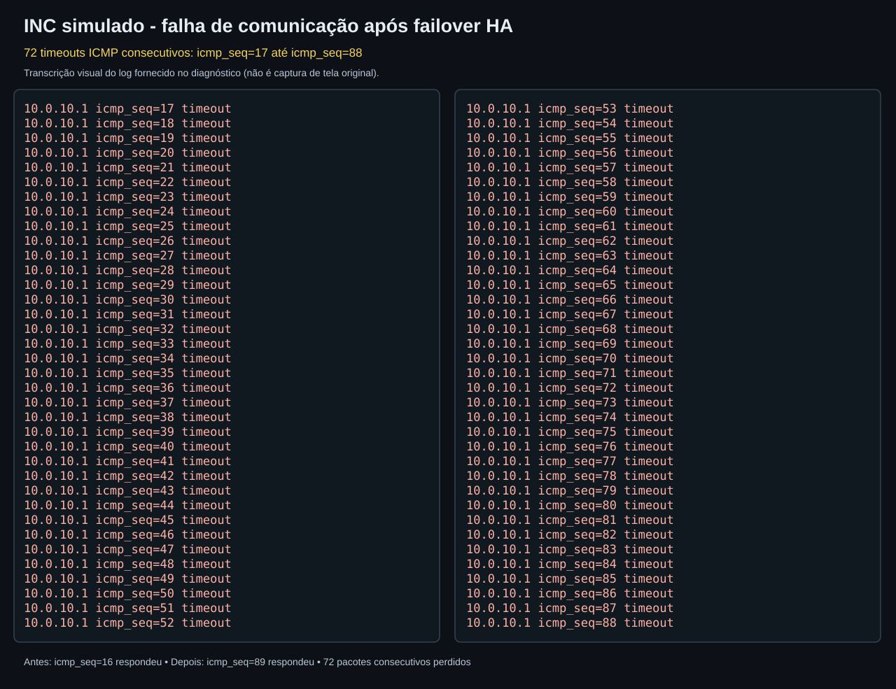

## 1. Baseline antes do failover

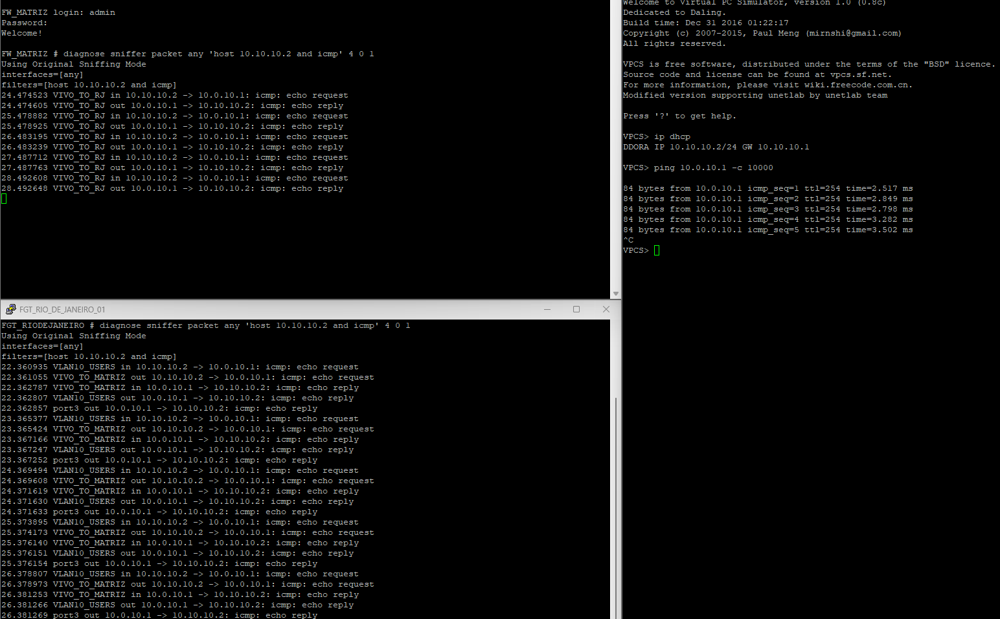

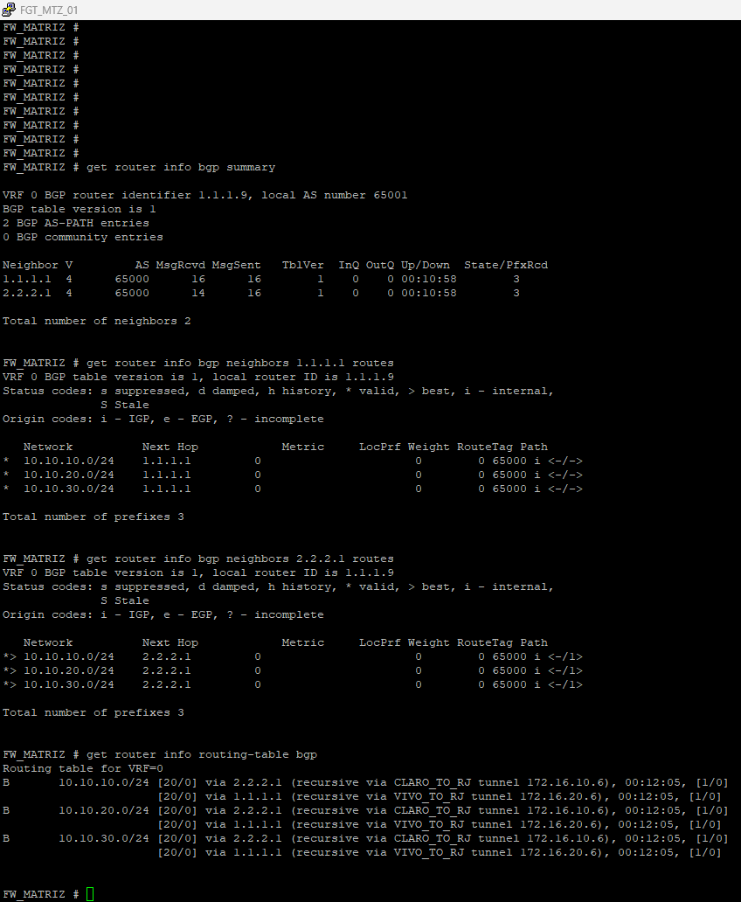

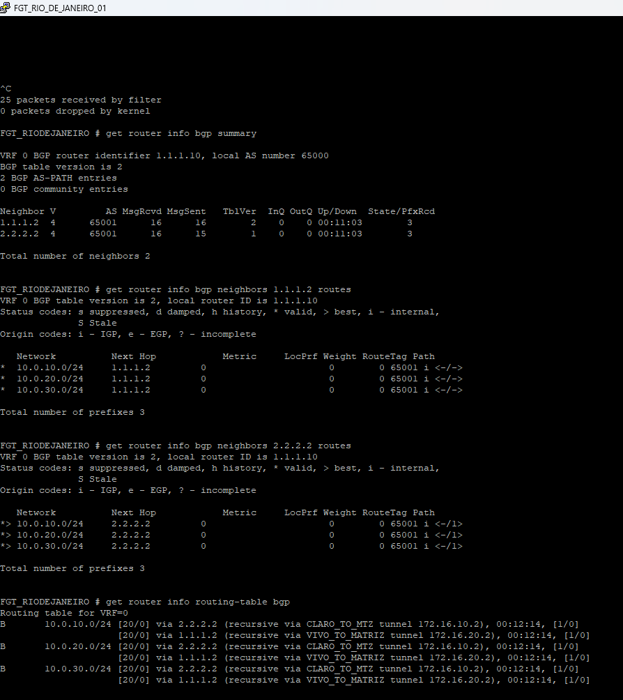

## 2. Falha reproduzida após o failover

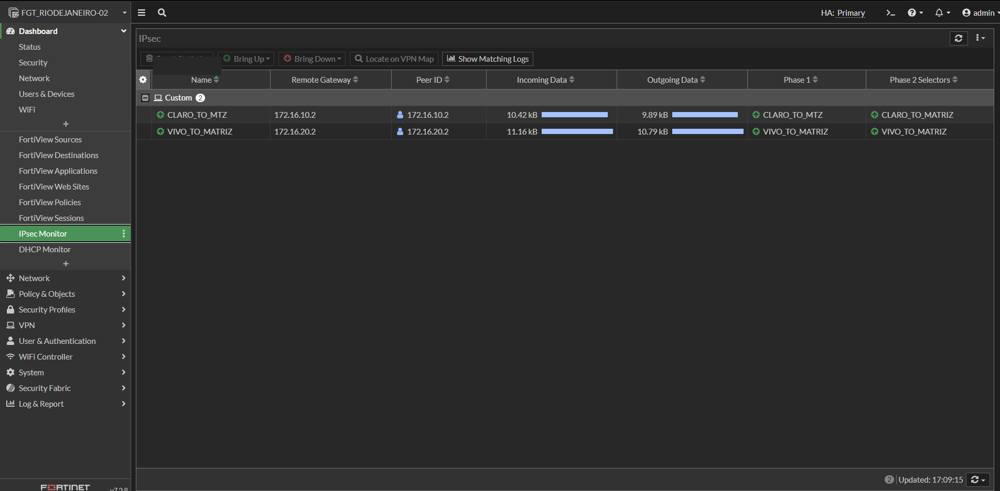

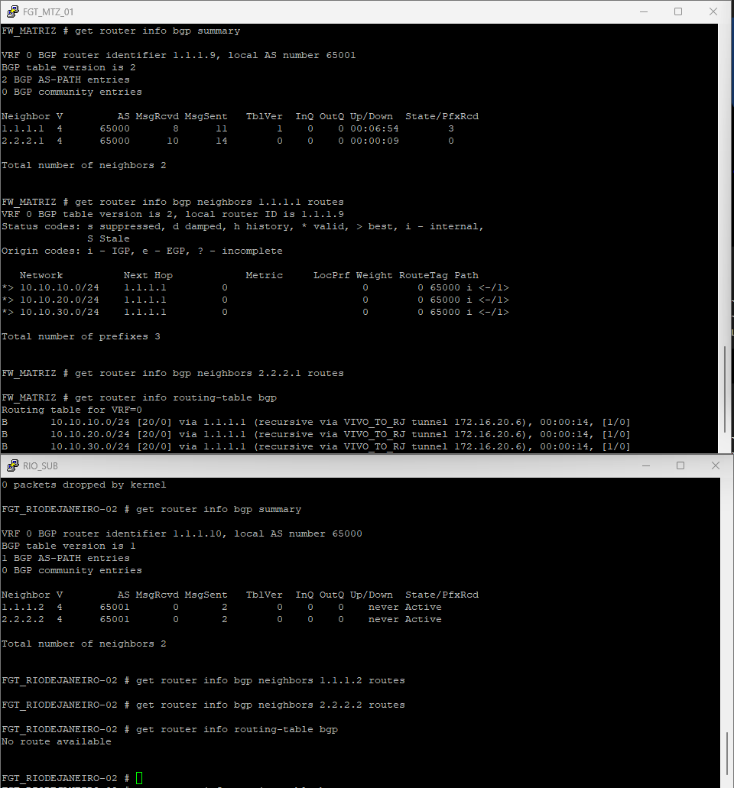

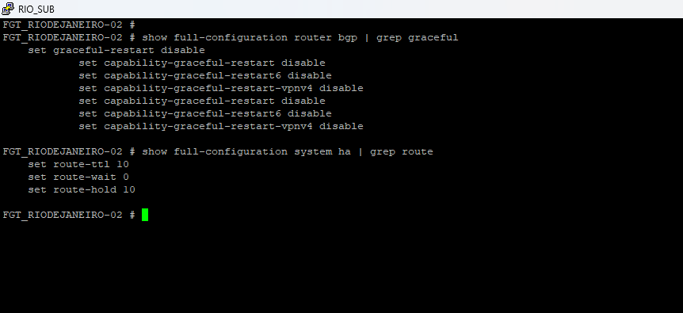

## 3. Reconvergência e ajustes

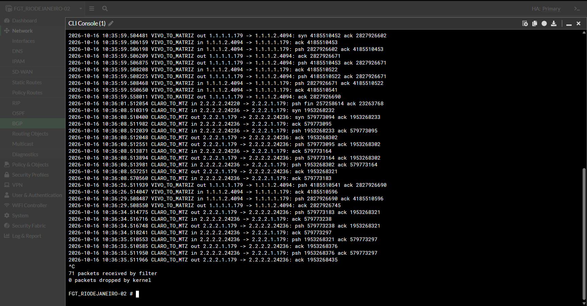

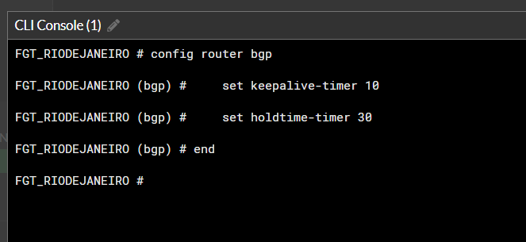

## 4. Causa da segunda interrupção

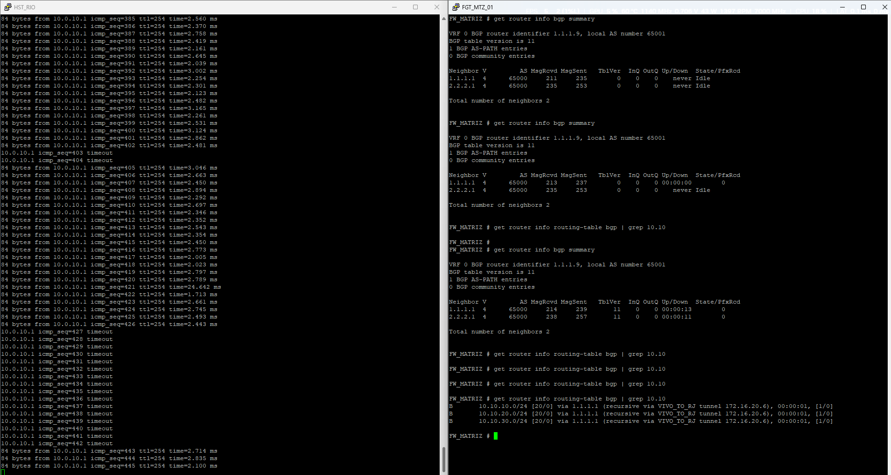

## 5. Ajuste final e resultado

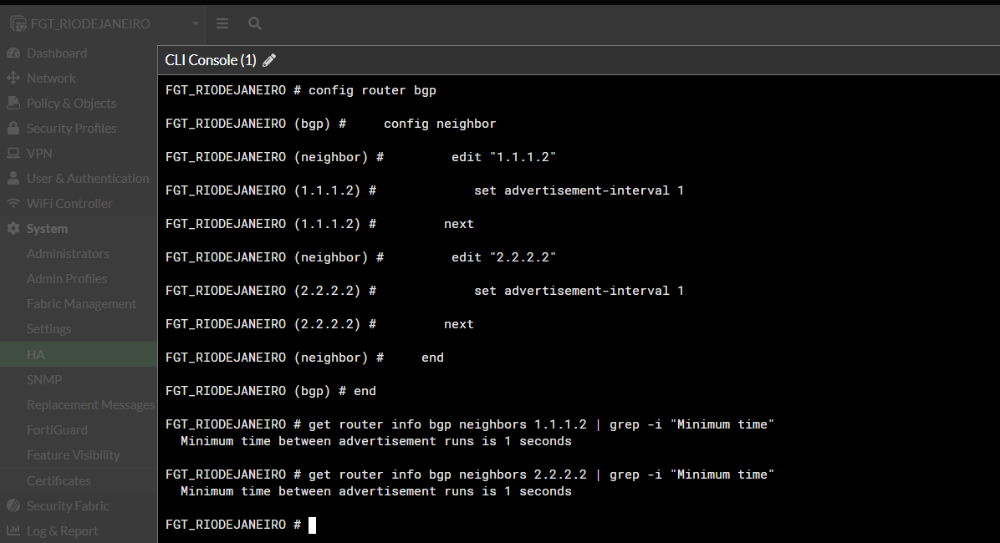

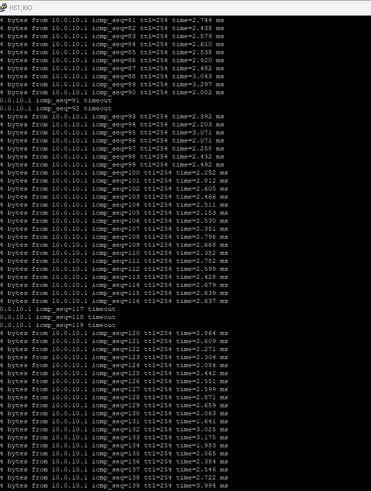
